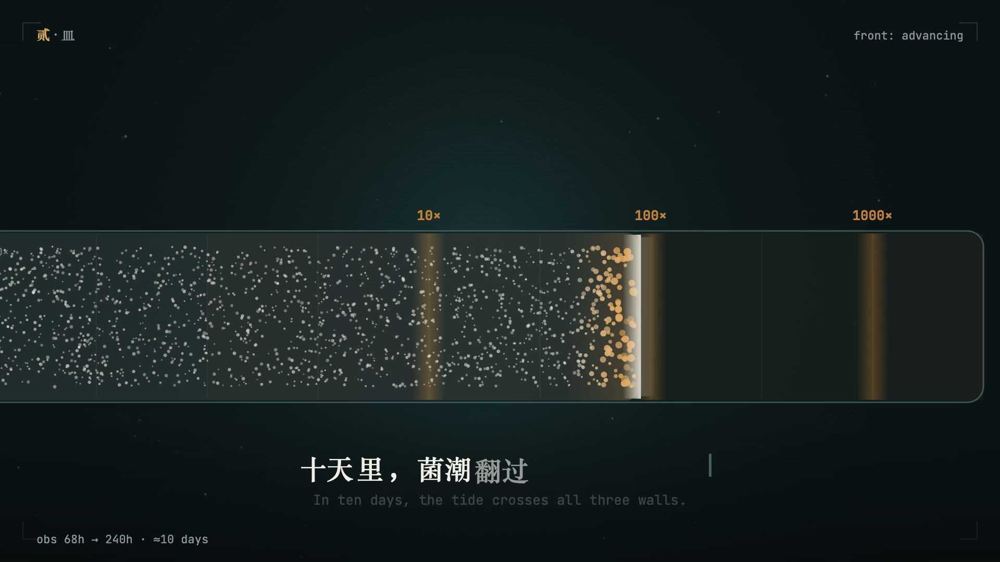
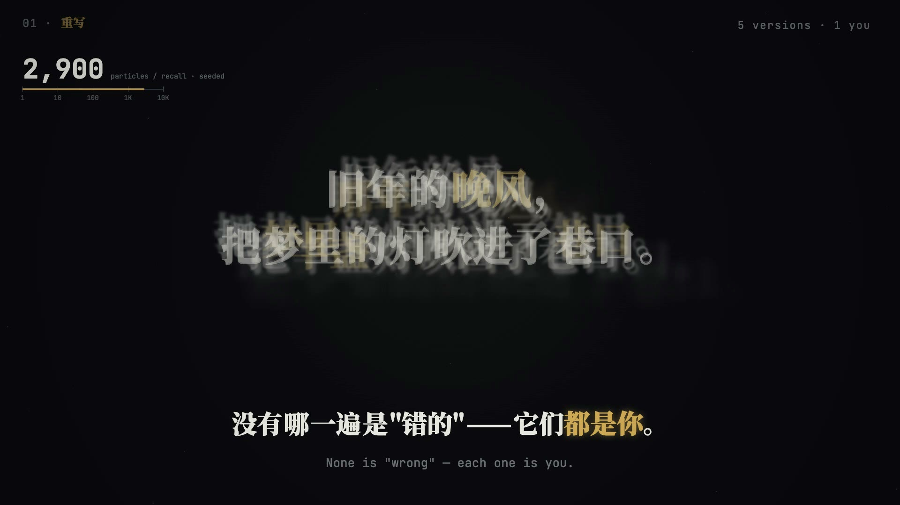
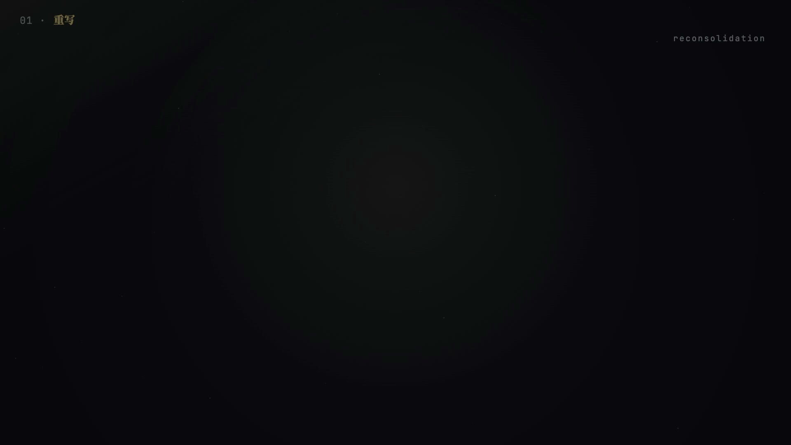
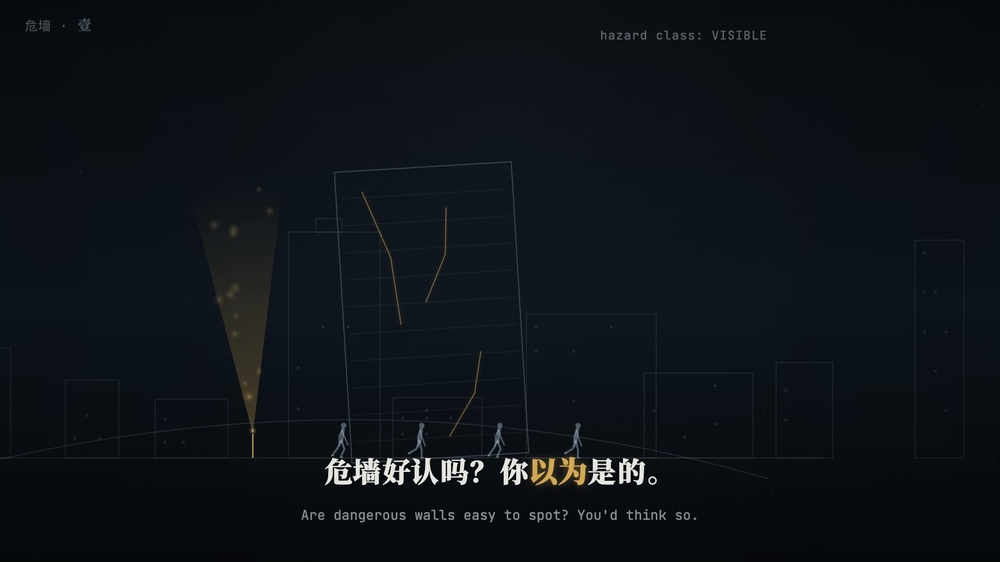
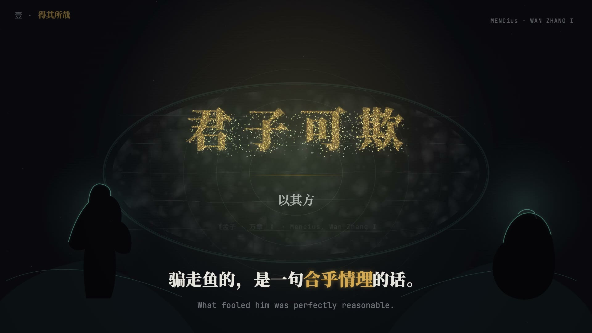
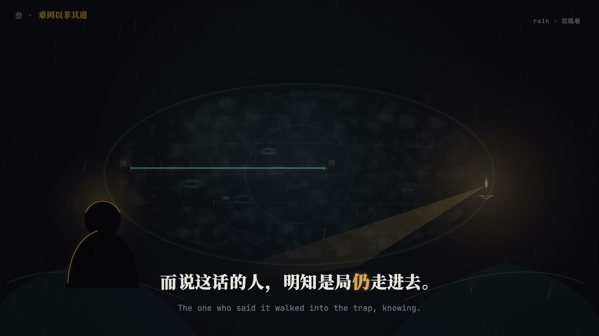
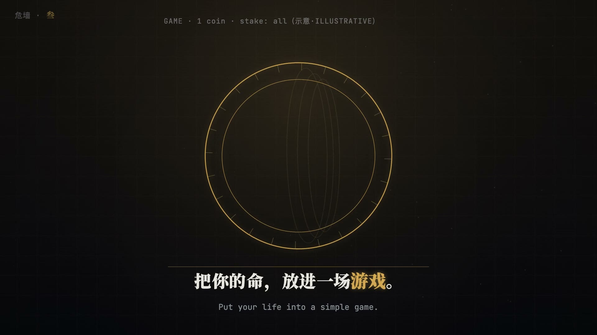
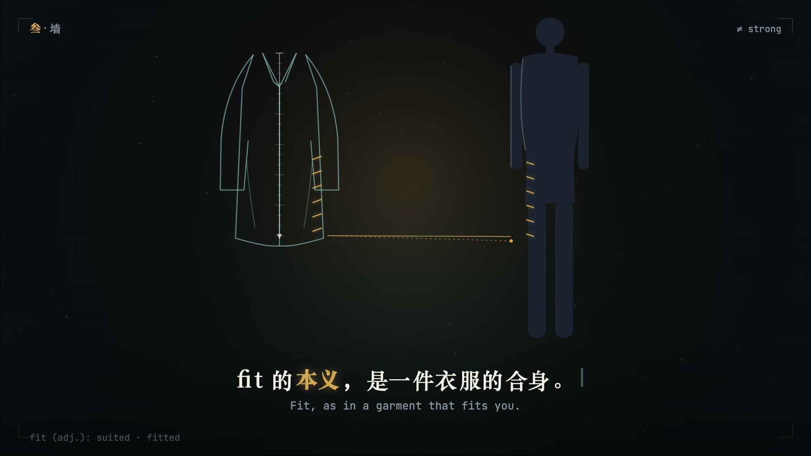

# vibe-film

**A coding-agent skill that turns one hard idea × one late-night feeling into a 2-4 minute no-voiceover knowledge short film — drawn frame by frame in code.**

把一个「硬核概念 × 半夜想的那件事」做成一支无口播知识情绪短片：观众读双语字幕，看画面把这句话演出来，结尾被一句「献给每一个___的人」点到。全片由代码逐帧画出——确定性渲染、纯音乐、帧级音画对位，同一帧跨渲染序像素级一致。

适用于 Claude Code、zcode 及其他按 AGENTS skills 约定读取技能目录的编码 agent。

   

[效果](#效果) · [快速开始](#快速开始) · [用法](#用法) · [它怎么工作](#它怎么工作) · [依赖](#依赖) · [结构](#结构) · [战绩](#战绩) · [边界](#边界)

---



两支真片的选题翻译，感受一下这个形态在做什么：

- **图灵停机问题** → 那个不肯点「保存」的你 → 「停是决定，不是证明」→ 献给每一个舍不得停下来的人
- **记忆是重构不是回放**（Bartlett 1932）→ 收藏夹里找不到的那篇文章 → 「记不清不是丢失，是压缩」→ 献给每一个怕自己开始忘记的人

## 效果

| | |
|---|---|
|  |  |
| 粒子文字签名镜：2,900 粒子聚散成句，seeded 可复算 | 界面仿真镜：收藏夹与搜索框的像素级还原 |
|  |  |
| 微缩场景镜：线稿城市与人物剪影 | 粒子金字镜：金句大字与剪影观众 |
|  |  |
| 单光源隐喻镜：光锥指向哪，观众看哪 | 几何道具镜：一个观众拿计算器能复现的数 |
|  | |
| 具象锚点镜：外行一眼认得的形象演概念 | |

全部帧 1920×1080 / 30fps，`render(t)` 契约：画面只由时间决定。

> 以上示例全部由 **GLM-5.3-Flash** 生成——该模型相对落后。skill 的规格和闸门负责兜住下限，产出上限取决于模型能力：更换更强的模型，效果会更好。

## 快速开始

**第一步**——发给你的 agent：

> 请安装 vibe-film skill：clone https://github.com/Ethanzyc/vibe-film 到本地，链接进你的 skills 目录

**第二步**——开工：

> /vibe-film 锚定效应

agent 会先过五问选题门、给你九列逐镜表人审，然后走完全部八步。

<details>
<summary>手动安装（不想让 agent 代劳的话）</summary>

```bash
git clone https://github.com/Ethanzyc/vibe-film.git ~/.zcode/skills/vibe-film        # 用户级（zcode）
# 或项目级（Claude Code 等）：
git clone https://github.com/Ethanzyc/vibe-film.git <项目>/.claude/skills/vibe-film

python3 ~/.zcode/skills/vibe-film/scripts/selftest.py    # 17 例全 PASS 即就绪
```
</details>

## 用法

**什么时候触发**：说「做一支 vibe 知识片 / 无口播知识短片」、丢一个概念要求拍成情绪片、或要求「哲学向知识动画」时使用。有人声口播的讲解片、剪辑已有素材、写实镜头为主的片子不适用（见[边界](#边界)）。

**说这些话的效果**：

| 你说 | agent 会 |
|---|---|
| 「把〈熵增〉做成一支片子，90 秒左右，结尾献给___」 | 走全流程默认值，分镜表人审后开工 |
| 「做一支关于『幸存者偏差』的片子。」 | 不直接开工——先回五问选题门，把「凌晨一点谁在搜这个」和献给句拿给你确认 |
| 中途改金句/献给句 | 定位修订成本路由表：改表→改段码→只重渲受影响段，重跑机审 |

**给好结果的三个习惯**：

1. **给真材料**：概念相关的文献、数字、年份——只用可溯源的事实，不编数据
2. **说清「记住哪句话」**：观众看完该记住的那句（说不清就让选题门替你提炼，但你要确认）
3. **定表现上限**：默认极限档（每片强制 1-2 个「人类动效师做不起、只有代码做得到」的能力展示镜）；要克制就说收敛档

## 它怎么工作

分工铁律：**人管选题、逐镜表、方向确认、验收；agent 管对标逆向、写码渲染、自查返工。** 八个步骤、四道人工闸门（🛑）、三个机器校验器：

```
0 环境检查（一次）
1 一次问清 ──────── 最多 5 问，能推断的就不问
2 选题门+逐镜表 ─── 五问门+锚点测试 → 三候选结构 → 九列表 → 🛑 人审
3 对标逆向 ───────── 逐张看对标帧，写可执行规范（先于写码）
4 音频先行 ───────── 🛑 BGM 小样试听 → 生成，impact 钉转折秒
5 风格帧+样片 ───── 🛑 风格帧拼图 + 能力展示镜 3-8s 无声样片
6 分段渲染 ──────── 段1 先行+契约基准截图 → 其余段并行 → 段内自查≥2轮
7 总装 ──────────── concat → 混音 → loudnorm
8 验收+交付 ─────── 技术检查（程序判，FAIL 不能交付）+ 审片（用户终审）
```

三个校验器把质量从「目测」变成「程序判定」：

- `check-storyboard.py` — 九列表机审：列数、时间连续性、双语、字幕时长、真曲落拍（FAIL 清零才准人审）
- `check-build.py` — 源码级对账：段代码字幕逐字 ↔ 分镜表、DUR ↔ 总时长、白闪对白名单、CUES 对段时长（像素 QC 的盲区由源码审计补）
- `selftest.py` — 校验器自检：17 例 planted-fault，好 fixture 必过、坏 fixture 必抓——**控制组不失败 = 检查器坏了**

改错了从哪来回哪里去：修订成本路由表按「最早出错阶段」定位，能局部修不全局重渲（SKILL.md 内置）。

## 为什么不是「会动的 PPT」

同一模型同一工具，一句话意图的分镜出「单主体+换字幕」，运动脚本级分镜能追平对标成片——对照实验证明**成片差距 60-70% 在分镜规格**。vibe-film 把这个差距做成机制：

- **五问选题门**：写不出「献给每一个___的人」不立项；第六问锚点测试——这颗概念的「微信气泡」是什么？找不到外行认得的具象形象就回选题层换，不带病写表
- **九列运动脚本级分镜**：时间/镜头类型/双语字幕/背景/中景/微文案/转场/情绪色逐镜锁死；九型镜头菜单（钩子帧/关系网络/介绍卡/粒子材料/数据叙事/隐喻/金句/献给/具象锚点）+ 渲染技术选型判断树（光行为→WebGL，3D→Three.js，排版→DOM/SVG，默认 Canvas）
- **对标帧逆向先于写码**：4-6 张同功能对标帧逐张看图写成可执行规范——审美靠比对收敛，不靠模型自由发挥
- **契约基准截图分段并行**：段 1 产基准截图，段 2..N 先读图再写码，共用 UI 像素级同构（纯文字契约已被实测证伪）
- **反 AI 味扣分制**：深色居中大字、整片一种入场、每拍 impact……命中即 -1/处，同一指纹 ≥3 处 = FAIL 必须改

## 音画：先出声，画面迁就它

- **合成 BGM**（`gen-audio.py`）：80BPM / Am-F-C-G / impact 钉转折秒，**吸气→静音→撞击**曲线——重拍前半拍全部让位，静音后的第一个声音是最重要的声音
- **真曲模式**（`beats.py`）：谱通量+自相关量出节拍网格，分镜表时间列直接写拍线小数秒，机审校验边界落拍（容差 ≈2 帧）
- **CUES 事件层**（音画同表）：段码里一处声明 `CUES=[{t,sfx}]`——画面读它做点亮脉冲，音频层用同一份出声（`gen-sfx.py` 合成点亮/跳动/聚合），一处声明两边消费，永不漂
- **量化自查**（`check-audio.py`）：drop 呼吸凹陷/抬升、响度、倍频程平衡——AI 听不见，所以只信测量

## 依赖

| 层 | 依赖 | 用于 |
|---|---|---|
| 分镜机审 + 源码对账（check-storyboard / check-build / selftest） | 仅 Python 3 标准库 | 每片必跑，零第三方 |
| 音频（gen-audio / gen-sfx / beats / check-audio / fit-grid / sfx_lib） | Python 3 + numpy + ffmpeg/ffprobe | 合成 BGM、真曲节拍网格、量化自查 |
| 渲染脚手架（assets/scaffold/） | Node 18+ + Playwright（系统 Chrome 即可）+ ffmpeg | 逐帧导出、段构建 |
| 字体子集（gen-fonts.mjs） | curl + 可达 fonts.googleapis.com | 出片前自托管字形 |

## 结构

```
vibe-film/
├── SKILL.md                    # 边界 + 八步流程 + 闸门 + 修订成本路由表 + 判例
├── references/
│   ├── topic-gate.md           # 五问选题门 + 锚点测试
│   ├── storyboard.md           # 九列逐镜表 + 九型镜头菜单 + 渲染技术选型 + 反 AI 味扣分制
│   ├── reverse-audit.md        # 对标逆向 + 九项密度清单 + 讲解设计
│   ├── audio.md                # 选曲决策树 + 合成配方 + 落拍三公式 + CUES 事件层 + 量化自查
│   ├── review.md               # 验收分离口径 + 审片十项 + 版本留档/四态复验 + 处方笺
│   └── workflow.md             # 标准布局 + 契约截图制 + 工单模板 + 交付清单 + 工时基线
├── scripts/                    # 3 个校验器 + 4 个音频工具 + 总装（见上表）
└── assets/
    ├── scaffold/               # 最小渲染脚手架：render(t) 契约页（含规则 helper）/逐帧导出器/字体子集器
    ├── contrast.md             # 正反例对照资产（越用越厚）
    ├── evals.md                # 端到端验收样例（expected=闸门证据清单）
    └── field-notes.md          # 实战笔记 + 被推翻规则销账（交付后回写，越用越厚）
```

## 战绩

| 片 | 时长 | 生产 | 结果 |
|---|---|---|---|
| 90s 首跑验证片（图灵停机问题） | 90s | 两段并行 | 三项工艺未验证项全部关闭 |
| 2:15 首支正片（RAG×记忆重构） | 2:15 | 四段并行 | 已定时发布（2026-11-08） |

v1.3-v1.8 期间产线续跑六支以上：matter.js 真刚体倒塌 + WebGL 体积光（能力展示镜首战）、荀子性恶论多工具并行、执笔动画、千级粒子菌潮梯度场等主题；`check-build.py` 对账在真实项目里抓出三例「工单偏差未回写表」。本页截图均出自产线成片。

## 边界

- **不适用**：有人声口播的讲解片（TTS 产线）、剪辑/混剪已有素材、写实镜头为主的片子（真人/实拍质感 >50% 时转混合路线）
- **时长**：90-135s 单项目（1-4 段，每段 ≤45s）；竖屏不支持（构图原生横屏）
- **写实人物**：代码画帧做不了实拍质感——遇到就风格化（剪影/几何拼装），或转生素材混合路线
- **慢是特性**：确定性逐帧渲染 + 三道机审闸门，快不了，也不该快

## License

[MIT](LICENSE) © 2026 Ethanzhu
